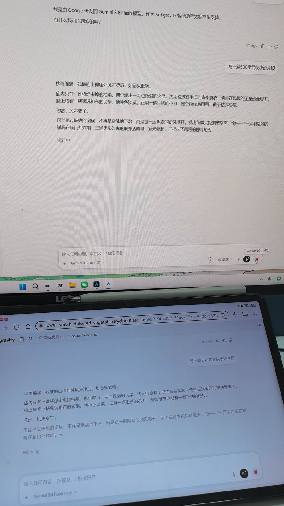

# Go-Antigravity

把 Antigravity 换成自己顺手的样子：原生 Windows 窗口、提示词精简、上下文放宽，外加一个**手机不用装代理、也不用登谷歌账号**的远程。

界面是 Python + PyQt6，后端是 Node.js，全在本机跑，不连旧运行时也不连更新服务。

## 🖼️ 界面预览

深色主题的「概览」和「账户」页，截图由 `desktop-qt/smoke_test.py` 用合成数据生成，不含真实账户：

## 📱 手机远程：不装代理，也不用登谷歌账号

官方那套远程绑在 Google 账号上：手机得能连上 Google，还得登录同一个账号，中间往往要自己开代理。我们换了个思路——把电脑上**同一个会话**经 Cloudflare 隧道变成一个普通 HTTPS 地址。

- 手机浏览器打开地址、输入 8 位 PIN，就接管了。手机上不装代理、不登谷歌账号，代理只要电脑这侧有。
- 地址两种：填一次 Tunnel Token 绑固定域名，重启也不变；临时用随机域名也行，每次启动会换。
- 手机上看到的就是电脑那个会话，消息、工具调用、审批实时同步。关窗口只是缩进托盘，隧道和会话照跑。
- PIN 每次启动重新生成，只在内存里，不写设置、日志和二维码。

*实拍：左桌面、右手机，同一个会话。固定域名和公网边界见 [MOBILE-ACCESS.md](MOBILE-ACCESS.md)。*

## ✨ 能做什么

- 🎨 **中文界面**：实时汉化，深浅两套主题，默认 1120×640。
- 🧠 **提示词档位**：官方原版，或「最大化精简」（核心模板压到 344 字节）；第一次改内核会自动留一份 `.bak`。
- 🪟 **上下文**：256K 或 512K 本机上限，换档按事务写入，随时能恢复默认。
- 👥 **账户**：授权添加、导入、切换，模型和周窗口配额一眼看到。
- 📊 **用量**：输入框旁的小圆环就是上下文占用，点开看模型、Token、TTFT/TPS。
- 🗂️ **托盘常驻**：点关闭只是隐藏，后端和隧道继续跑；右键「退出」才真结束。
- 🧾 **日志**：筛选、复制、清屏，敏感内容自动遮盖。

## 🚀 从源码跑起来

要 Python 3.10+ 和 Node.js 22.13+，然后：

~~~bat
Start-Go-Antigravity.cmd
~~~

脚本自己建 `.venv-qt`、按锁文件装依赖，装好就复用；账户、设置、日志落在 `.go-antigravity-data/`。只想看看界面：`Start-Go-Antigravity.cmd --demo`（合成数据，不碰真实账户）。

以后改功能就在这个克隆里改，别去 `dist/`、`runtime/`、`.venv-qt/`、`backend/node_modules/` 或发布包解压目录里动代码；目录分工见 [DEVELOPMENT.md](DEVELOPMENT.md)。

## 📦 Windows 版

到 [Releases](https://github.com/cooleava1-gif/Go-Antigravity/releases) 下 `Go-Antigravity-windows-x64.exe`，放个固定位置双击：它会在旁边解出 `Go-Antigravity-windows-x64` 目录并启动。包内自带 Node 和 Python/PyQt 运行时，不用另装；本机的 Antigravity 客户端还是要有，内核补丁会打到它身上。源码树里那个 `Go-Antigravity.exe` 只是启动入口，单独拷走没用。

- **升级**：双击新版 EXE 就行，它比完版本就地替换，旧目录留成 `<安装目录>.backup-<时间戳>`，用着没问题再删。
- **在线更新**：桌面端会自己查 Releases，下载同一个 EXE 并按 GitHub 给的 SHA-256 核对，你确认关闭后由外部助手替换目录再重启。
- **数据不动**：账户和设置放在 `%LOCALAPPDATA%\Go-Antigravity`，不在安装目录里。

自己打包（目录 → ZIP → 合成 Release 用的单文件）：

~~~powershell
npm --prefix backend ci
python -m venv .venv-qt
.\.venv-qt\Scripts\python.exe -m pip install -r desktop-qt/requirements.txt
powershell -NoProfile -ExecutionPolicy Bypass -File scripts/package-windows.ps1 -Clean
powershell -NoProfile -ExecutionPolicy Bypass -File scripts/build-portable-exe.ps1 -PackageZip dist/Go-Antigravity-windows-x64.zip -OutputDirectory dist
~~~

最后一条把目录和 ZIP 合成 Release 上唯一的那个下载文件，ZIP 和 `.zip.sha256` 只是中间产物。EXE 还认 `--extract-only`（只解压）、`--target <目录>`（指定安装目录）、`--force`（强制覆盖）。

## 🛠️ 开发与发布

版本号只有一个来源：`backend/package.json`（现在 `1.1.1`）。标签必须是 `v1.1.1` 这种写法，不然 CI 直接挂；推标签就会跑「校验 → 打包 → 冒烟 → 合成 EXE → 解包复核 → 发 Release（只传那一个 EXE）」。

~~~powershell
git tag v1.1.1
git push origin v1.1.1
~~~

界面和验证命令见 [FRONTEND.md](FRONTEND.md)，服务、数据与清理边界见 [PORTABLE.md](PORTABLE.md)，发布细节见 [RELEASE.md](RELEASE.md)。后端自测：`cd backend && npm ci && npm run verify`。

## ⚠️ 三句实话

- PIN 就是你桌面 API 的钥匙，别跟网址一起发出去。
- 账户令牌默认由 Windows 凭据管理器加密，但同一个 Windows 用户下的其他程序不算隔离；带完整令牌的备份别外传。
- 512K 只是本机上限：不加额度，也不保证上游肯收。代理走电脑这侧的 HTTP / mixed 端口（单独 SOCKS 不行），而且只有经本工具启动的 Antigravity 才会带上代理参数。

## 🙏 致谢

汉化词典来自社区整理，谢谢 nicktan @ [linux.do](https://linux.do)。

许可见 [LICENSE](LICENSE)，第三方依赖见 [第三方声明](backend/THIRD-PARTY-NOTICES.md)。
