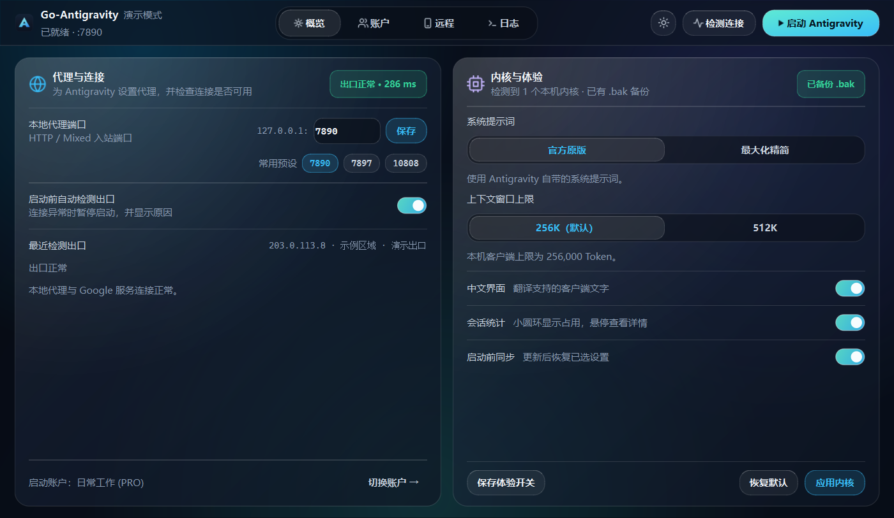
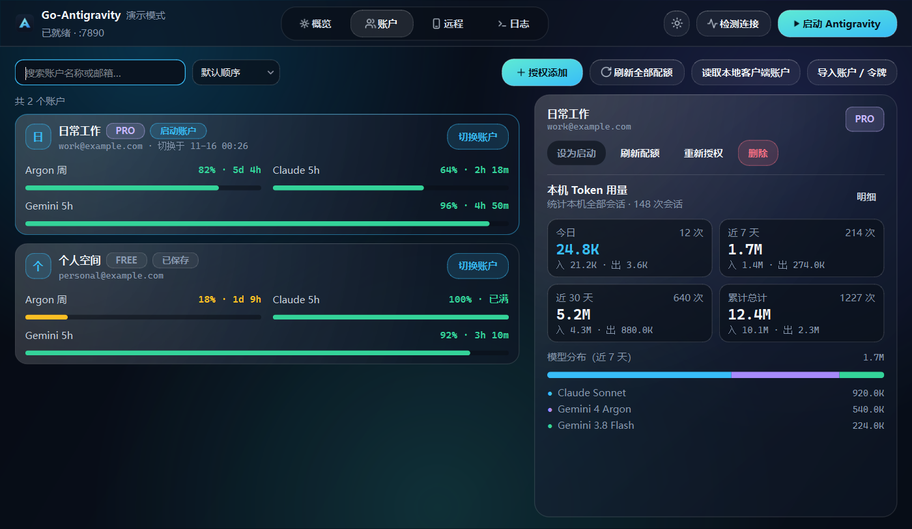

# Go-Antigravity

Go-Antigravity 是独立维护的 Windows 桌面工具。Python / PyQt6 提供原生界面，Node.js 后端随源码在本机启动，无需连接旧运行时或更新服务。第三方依赖的许可清单见 [第三方声明](backend/THIRD-PARTY-NOTICES.md)。

## 界面预览

深色主题的「概览」与「账户」页；截图由 `desktop-qt/smoke_test.py` 使用合成数据生成，不含真实账户：

## 以后从哪里继续

唯一的开发源目录是当前克隆下来的项目根目录。以后修改功能、界面、内核补丁或发布流程，都在这里编辑并提交；不要在 `dist/`、`runtime/`、`.venv-qt/`、`backend/node_modules/` 或发布包解压目录里改代码。

先看 [DEVELOPMENT.md](DEVELOPMENT.md) 了解目录分工和日常命令。根目录的 `Go-Antigravity.exe` 只是由 `desktop-qt/build-launcher.ps1` 生成的启动入口，真正的功能代码在 `desktop-qt/` 和 `backend/`。

## 从源码启动

安装 **Python 3.10 或以上**，以及 **Node.js 22.13 或以上（含 npm）**，然后在项目根目录运行：

~~~bat
Start-Go-Antigravity.cmd
~~~

启动脚本会在项目内建立 `.venv-qt`，并按 `desktop-qt/requirements.txt` 安装固定版本依赖；后端依赖按 `backend/package-lock.json` 安装。首次准备环境需要联网，安装失败会停止并显示原因。已经准备好的环境会复用。Python 虚拟环境不能直接跨电脑搬运。

启动脚本使用 `PATH` 上安装的 Node.js，不查找或启动旧式便携运行时。源码不包含 EXE、虚拟环境或 `node_modules`。账户、设置和日志默认写入项目根目录的 `.go-antigravity-data/`；不会自动读取或迁移旧版账户、配置或加密密钥。

预览界面可运行 `Start-Go-Antigravity.cmd --demo`，只使用合成数据，不连接真实账户或服务。仍需安装 Python 与界面依赖。

## 界面与功能

横向桌面包含「概览」「账户」「远程」「日志」四个页面，提供深色与浅色主题，默认窗口 `1120×640`，最小 `940×580`。

- 概览：代理端口与连接诊断、中文界面、会话统计、系统提示词和上下文窗口。
- 账户：授权添加、读取本地客户端账户、搜索排序、切换、模型与周窗口配额、导入账户 / 令牌、重新授权。
- 远程：随机公网隧道或固定域名、Tunnel Token 本机加密保存、二维码、临时 PIN 和服务控制。
- 日志：文本筛选、复制、清屏和敏感内容遮盖。

系统提示词可以选「官方原版」（默认）或「最大化精简」。精简版的三个核心模板合计 344 字节，保留授权范围、查证、工具使用和结果核验规则。启动同步和单独调整上下文时，已安装的旧版提示词会保留。应用所选提示词档位后才会切换，旧自定义档可用「恢复默认」还原。

「最大化精简」重写 `guidelines.tmpl`、`function_call.tmpl`、`communication_style.tmpl`，保留身份、工具声明、技能和项目上下文等辅助模板，并兼容旧内核的启动校验。首次修改内核时创建一次原始 `.bak` 并启用 NTFS 压缩（`compact.exe`，本机实测 194 MB → 约 109 MB，约 1.8:1），之后复用同一份备份；补丁失败时按变更区间把原始字节写回，不再复制整份镜像，只有区间写回本身失败时才额外留下一份显式的恢复快照（`.go-antigravity-*.tmp`），可直接拷回。请按敏感文件保护备份目录。

上下文可以选「256K（默认）」或「512K」，对应本机客户端上限 256,000 或 512,000 Token。旧 900K／1M 设置迁到 512K，旧「官方原版」上下文设置迁到 256K。「恢复默认」同时选回官方系统提示词和 256K。这只调整本机上限，不增加账户额度、解锁模型，也不保证上游接受 512K 输入；配额读取依赖 Antigravity 内部接口，上游变更时可能暂不可用。

客户端输入区只显示小圆环与百分比，悬停或点击展开关键统计：估算上下文、模型、本对话输入／输出 Token，以及有有效样本时的平均 TTFT 和 TPS。不可用的统计行自动隐藏，不展示系统／工具拆分、缓存与时长占位项。Token 为当前对话的宿主累计口径，不与当前上下文或全账户用量混同。

当前桌面账户工具栏不提供导出按钮。后端保留受本机会话保护的导出接口；脱敏资料不能恢复账户，包含完整令牌的备份不可公开分享。

启动时优先沿用 Antigravity 客户端已有的登录。只有客户端没有登录，或你在账户页明确点击「设为启动」时，才使用工作台保存的启动账户。点「取消指定」可恢复优先沿用客户端登录。

内核修改需确认，首次修改会保留原始二进制备份；上下文配置按事务更新并记录原字段值，以便恢复。切换账户前请先保存工作并退出 Antigravity；运行状态无法确认或客户端仍在运行时会取消切换。切换成功后，下次启动客户端时生效。修改 Python 后重新启动桌面；修改后端后需重启实际使用的服务，仅重新打开桌面不会重启复用的服务。

点击窗口关闭按钮会隐藏到系统托盘，本次启动的后端、托管手机服务和隧道继续运行。右键托盘图标选择“退出”才会真正关闭 Go-Antigravity；有未保存设置时先提示确认，复用的外部服务保持运行。双击托盘图标或选择“显示主窗口”可恢复窗口。系统托盘不可用时回退为正常退出。PIN 默认遮盖，离开「远程」页或窗口失焦会重新遮盖。手机使用与配置见 [MOBILE-ACCESS.md](MOBILE-ACCESS.md)。

## 不开 TUN 时的代理

概览页填写本地 HTTP 代理或支持 HTTP CONNECT 的 mixed 端口即可。工具自身的授权码兑换、Token 刷新、用户信息、配额和代理预检使用该端口，无需 TUN；单独 SOCKS 端口不支持。显式代理不会被继承的 `NO_PROXY` 绕过，配置了代理但缺少 `curl.exe` 时会报错并停止请求。

通过本工具新启动 Antigravity 时会传入代理启动参数和环境变量；已经运行的客户端不会被补注入，需使用原有代理配置或退出后重新启动。Antigravity 原生子进程是否遵守代理由其自身实现决定；系统默认授权浏览器遵守浏览器／系统设置，cloudflared 的公网连接也不在上述显式代理保证内。本地回环接口保持直连。预检成功不能证明真实账户的地区资格或所有客户端流量可用。

## 本地数据与调试权限

账户令牌默认加密保存，Windows 主密钥位于当前用户的凭据管理器。同一 Windows 用户运行的其他程序不在此加密的隔离边界内；请勿分享完整令牌备份。工具只读本地会话元数据来统计 Token，用量累计值不等于当前上下文。

中文界面、上下文监控与空白页恢复依赖本机回环 CDP 调试端口；CDP 没有独立登录，能访问该端口的本地程序具有页面调试能力。代理出口预检成功后会通过所选代理查询第三方出口 IP/地区信息（ipinfo.io / ip-api.com），不发送账户令牌或对话。手机 PIN 会话的权限和公网边界见 [MOBILE-ACCESS.md](MOBILE-ACCESS.md)。

## Windows EXE 发布包

源码树中的 `Go-Antigravity.exe` 是带图标的原生入口。要生成可放到 GitHub Releases 的 Windows x64 包，在项目根目录执行：

~~~powershell
npm --prefix backend ci
python -m venv .venv-qt
.\.venv-qt\Scripts\python.exe -m pip install -r desktop-qt/requirements.txt
powershell -NoProfile -ExecutionPolicy Bypass -File scripts/package-windows.ps1 -Clean
~~~

脚本会在 `dist/Go-Antigravity-windows-x64/` 生成 `Go-Antigravity.exe`、后端、桌面文件、锁定的 `node_modules`、Node.js 运行时和可搬运的 Python/PyQt 运行时，并同时生成同名 ZIP。发布包运行时不执行 npm/pip，也不需要用户另外安装 Python 或 Node.js；首次使用时仍需要用户本机已有的 Antigravity 安装，内核补丁会在本地应用到该安装。

ZIP 和同名 `.zip.sha256` 只是构建产物，不进 Release。发布前再跑一次自解压打包脚本，把目录和 ZIP 合成 GitHub 上唯一的那一个下载文件：

~~~powershell
powershell -NoProfile -ExecutionPolicy Bypass -File scripts/build-portable-exe.ps1 -PackageZip dist/Go-Antigravity-windows-x64.zip -OutputDirectory dist
~~~

`dist/Go-Antigravity-windows-x64.exe` 是原生启动程序加追加在末尾的发布 ZIP：双击后解压到同级的 `Go-Antigravity-windows-x64` 目录并启动；`--extract-only` 只解压不启动，`--target <目录>` 指定安装目录本身（默认是 EXE 旁边的 `Go-Antigravity-windows-x64`），`--force` 强制覆盖。EXE 的文件版本号取自包内 `runtime/manifest.json`，启动时会和解压目录里的版本比对，相同就跳过解压直接启动，不同则就地替换（旧目录先改名保留，成功后删除）。

安装后仍是“目录型”布局：EXE 只负责把同一份目录解压到位，不是把所有运行时压成单个二进制文件。运行时版本、构建提交、交付源码的修改状态与内容指纹写入 `runtime/manifest.json`（`dirty` 只反映交付文件，不表示整个 Git 工作树是否干净）；Python、Qt、Node 及后端依赖的许可文件随包保留。包内账户、设置和日志默认写入 `%LOCALAPPDATA%\Go-Antigravity`，不会写进发布目录。

### 安装与在线更新

把发布 EXE 放到一个固定位置（例如 `%LOCALAPPDATA%\Programs`）双击运行，它会在旁边解出 `Go-Antigravity-windows-x64` 目录并启动其中的 `Go-Antigravity.exe`；也可以手动解压 ZIP 后运行目录里的 `Go-Antigravity.exe`，但不要只复制源码树里的启动入口。桌面端启动后会检查 GitHub Releases 上的最新版本，下载那个单文件 EXE，按 GitHub 接口给出的 SHA-256 核对，从中取出发布 ZIP 解到安装目录旁边，再在你确认关闭之后由外部 PowerShell 助手替换安装目录并重启。

- 账户数据不受影响：数据目录默认是 `%LOCALAPPDATA%\Go-Antigravity`，不在安装目录里，更新不会删除或迁移账户、设置和日志。
- 用 `--data-dir <目录>` 指定的数据目录会被更新后的重启继承；安装目录本身不能同时作为数据目录。
- 替换前旧目录会保留为 `<安装目录>.backup-<时间戳>`，出错时自动回滚，确认无误后可自行删除。
- 源码开发目录不会被覆盖：在线更新只作用于正式安装的发布目录。

从源码树第一次迁移到发布包时，用 `Go-Antigravity.exe --data-dir <原源码目录>\.go-antigravity-data` 启动即可沿用原来的账户与设置，不需要复制账户文件。

仅需构建带图标的入口时，仍可单独运行：

~~~powershell
powershell -NoProfile -ExecutionPolicy Bypass -File desktop-qt/build-launcher.ps1
~~~

## 开发与发布

界面结构和验证命令见 [FRONTEND.md](FRONTEND.md)，服务、数据、备份与清理边界见 [PORTABLE.md](PORTABLE.md)。后端可在 `backend/` 中执行 `npm ci` 和 `npm run verify`。

### 版本与标签

版本号只有一个来源：`backend/package.json` 的 `version`（当前 `1.1.0`），`backend/package-lock.json` 同步同一个版本号。发布标签必须等于 `v<版本号>`（例如 `v1.1.0`）；CI 在标签与 `backend/package.json` 不一致时直接失败，手动触发发布工作流时不带标签，使用 `backend/package.json` 的版本号。

~~~powershell
git tag v1.1.0
git push origin v1.1.0
~~~

推送标签会触发发布工作流：校验 → 打包 → 校验交付源码与校验文件 → 冒烟测试 → 打成单文件 EXE → 解包复核交付源码与版本 → 发布 Release（只上传这一个 EXE）。只有打标签才会发布，普通提交不会自动发版。

桌面端支持从 GitHub Releases 在线检查更新（见上文“安装与在线更新”）；旧 `runtime/current` 覆盖层仍不会替换当前源码。Google Antigravity 的官方联网依赖，以及启用手机公网远程时可选的 Cloudflare Tunnel，是独立于旧发布方的服务；仅预览界面可用 `--demo`。本源码树来自核准文件清单，使用独立 Git 历史，不继承原开发仓库的提交、标签和远程配置。源码发布步骤和 Windows 包发布步骤见 [RELEASE.md](RELEASE.md)；不要上传整个开发目录。

项目许可证见 [LICENSE](LICENSE)。PyQt6 / Qt / Node 等第三方依赖的许可证清单见 [第三方声明](backend/THIRD-PARTY-NOTICES.md)；内核补丁为仓库内独立实现，不加载也不打包任何外部补丁工具，公开分发前仍需核对实际 Antigravity 客户端文件与可选运行时组件的许可条件。

## 致谢

汉化词典来源于社区整理，包括 nicktan @ [linux.do](https://linux.do)。
